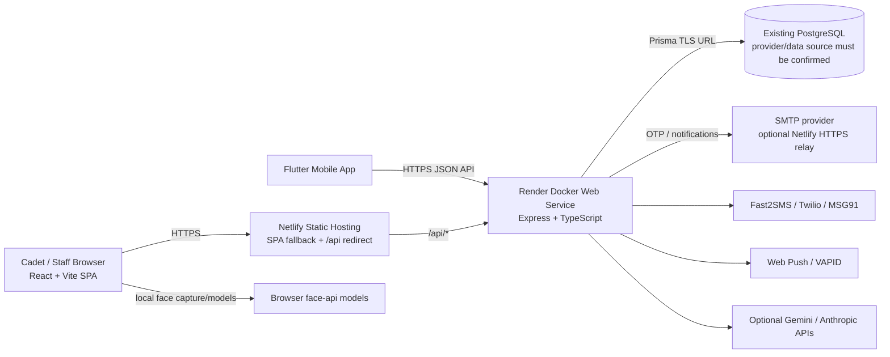

# NCC Production Deployment Readiness

**Audit date:** 16 November 2026  
**Repository:** `SYEDABRAR037/AIT_NCC`  
**Local branch inspected:** `deployment-preparation` (local only; no commit or push)
**Deployment state:** Not production-ready; no service was deployed or paid resource provisioned.

## Executive summary

The repository contains a substantial, implemented NCC web/mobile system: a React/Vite web SPA, a Node/Express TypeScript API, a Prisma/PostgreSQL schema, and a Flutter mobile client. The repository includes Netlify, Render, Docker, and database migration documentation. This is not a frontend-only project.

The website and API are not currently reachable at the deployment URLs documented in the repository. The Netlify address shows a “Site not found” page, the Render API health URL returns HTTP 404, and no API process is listening on local port 5050. The screenshot's recovery error is therefore consistent with a missing/unreachable API. The frontend route and backend recovery route exist in source; the current failure is infrastructure availability/configuration, with a separate email-relay source defect also found and fixed locally.

PostgreSQL is already part of the codebase. Read-only inspection found local PostgreSQL 18.4 database `ncc_local_dev`, five account rows including one CADET role, and one applied baseline migration. A verified local dump is documented in `DEPLOYMENT_SETUP_CHECKLIST.md`. The separate Supabase staging configuration was not contacted. Do not provision an empty production database or run migrations/seeds until the current data source is confirmed.

## Readiness by component

| Component | Status | Finding |
|---|---|---|
| Web frontend source/build | READY | React 19, TypeScript and Vite SPA; production build passes. |
| Mobile client source | READY | Flutter/Dart app is present and consumes the API; release API origin is compile-time configuration. |
| Backend source | READY | Express API and controllers are implemented; there is no reachable deployed API. |
| API endpoint configuration | NEEDS CONFIGURATION | Netlify proxy and frontend fallback still reference the documented Render hostname, which currently returns 404. |
| Database engine/schema | READY | PostgreSQL + Prisma schema and three migration files exist. |
| Existing database/data | NEEDS CONFIGURATION | Read-only inspection found PostgreSQL 18.4 database `ncc_local_dev`, five account rows including one CADET role, and one applied baseline migration. A verified local dump is documented in `DEPLOYMENT_SETUP_CHECKLIST.md`. |
| Production database | BLOCKED | No confirmed production database/service; do not create a new empty database until existing records are accounted for. |
| Authentication/RBAC | READY | JWT/session authentication, password hashing, OTP verification, and server role checks are implemented. Runtime is unverified. |
| Account recovery | NEEDS CONFIGURATION | Routes and UI exist. No reachable backend or verified delivery provider; live workflow could not run. |
| SMTP/recovery email | NEEDS CONFIGURATION | Brevo HTTPS API support is prepared locally for OTP; verified sender and API key are not configured and no message was sent. |
| Netlify deployment | BLOCKED | Config is present, but the documented public site currently serves Netlify “Site not found.” |
| Render backend deployment | BLOCKED | Blueprint exists, but the documented API host/health path returns 404. Blueprint has no database resource or required API secrets. |
| Health checks | READY | Liveness and DB-readiness routes exist. The local Render health path has been changed to the readiness endpoint. |
| File storage | NEEDS CONFIGURATION | Uploaded images are stored as PostgreSQL binary columns; no external object store is configured. |
| AI integrations | NOT CONFIGURED | Code supports Anthropic/Claude and Gemini; local keys are placeholders/unconfigured. |
| SMS/WhatsApp/push | NEEDS CONFIGURATION | Provider adapters exist; production credentials and sender registrations are not verified. |
| Automated backups/restore | NEEDS CONFIGURATION | Runbooks exist, but no production backup policy or restore drill is verified. |
| Git secret hygiene | BLOCKED | Environment files are ignored, but public deployment documentation contains privileged-looking default credentials. They have been removed from the local working copy only; the public GitHub copy/history still needs an approved cleanup and any active credentials must be rotated. |

## Technology and repository map

| Layer | Technology | Main locations |
|---|---|---|
| Web frontend | React 19, TypeScript, Vite, React Router | `frontend/src`, `frontend/package.json` |
| Web hosting | Netlify static build, SPA fallback, API redirect, Functions | `netlify.toml`, `frontend/netlify.toml`, `frontend/netlify/functions` |
| API | Node.js 22 image, Express 4, TypeScript | `backend/src/server.ts`, `backend/src/routes`, `backend/src/controllers` |
| ORM/database | Prisma 6, PostgreSQL 16 compatible | `backend/prisma/schema.prisma`, `backend/prisma/migrations` |
| Authentication | bcrypt password hashes, signed JWT, persisted auth sessions, HTTP-only cookie plus bearer compatibility, OTP verification | `backend/src/controllers/auth.controller.ts`, `otpAuth.controller.ts`, `recovery.controller.ts`, `backend/src/middleware/auth.middleware.ts` |
| Mobile | Flutter / Dart | `mobile/lib`; API origin supplied with `NCC_API_BASE_URL` at release build |
| Containers | Docker, Docker Compose, Nginx | `backend/Dockerfile`, `frontend/Dockerfile`, `frontend/nginx.conf`, `docker-compose.yml` |
| File handling | Multer memory upload; image bytes in PostgreSQL | `backend/src/routes/media.routes.ts`, `backend/src/controllers/media.controller.ts`, Prisma `GalleryPhoto` and `RankHolder` |
| AI / ML | Browser-side face-api models and vector capture; optional Gemini/Anthropic assistant; Wikipedia/DDG research | `frontend/public/models`, `backend/src/services/aiAssistant.service.ts`, `backend/src/controllers/attendance.controller.ts` |
| Messaging | SMTP/Nodemailer and Netlify relay for email; Fast2SMS/Twilio for SMS; MSG91 attendance WhatsApp; Web Push | `backend/src/services/mail.service.ts`, `attendanceNotification.service.ts`, `notificationDelivery.service.ts`, `frontend/netlify/functions/email-relay.ts` |

The Prisma schema declares **41 models and 3 enums**. Its data areas include users and role/status, senior/platoon/drill assignments, review workflows, sessions and recovery/OTP, attendance/training/biometrics, leave/requests/duties, camps/events/notices/achievements, certificates, media, audit history, notifications, and performance assessment/snapshots. This is a relational Postgres design; no MongoDB or separate object-store client is present.

## Architecture

Recommended deployment keeps this architecture: Netlify serves the static SPA; Render runs the existing Express Docker API; Prisma connects to the confirmed existing PostgreSQL service over TLS; the backend alone holds mail, AI, SMS and signing secrets. The mobile app uses the same backend but needs its release base URL changed/rebuilt when the API origin changes.

## Backend, health and authentication audit

- The API mounts route groups for public data, auth, admin, hierarchy, reviews, leave, attendance, certificates, notifications, assistant, requests, timeline, calendar, duties, camps, dashboards, service records, performance, ranks, media, search and digital IDs.
- `GET /api/health` is a liveness response and does not query PostgreSQL. `GET /api/health/ready` performs `SELECT 1` and returns 503 when the database is unavailable. Render and Docker health checks now use the readiness route in the local working copy.
- Auth uses database-derived roles and account status, bcrypt password hashes, JWT/session records, OTP challenges, role middleware and session revocation. Public registration defaults to cadet/review status; recovery changes only the password and does not promote a role or activate an account.
- Recovery endpoints are registered at `/api/auth/recovery/request-otp`, `/resend-otp`, `/verify-otp`, and `/reset-password`. They require registered email plus regimental identifier, deliver OTP by email, store bcrypt OTP hashes, enforce expiry/attempt/resend limits, then issue a short-lived reset token. Real mail delivery remains unverified.
- IP/account throttling partly uses process-local memory; this does not coordinate across multiple Render replicas. A shared store or database-backed limiter should be added before horizontal scaling.
- The backend starts a notification-delivery loop in the web server process. If the service is scaled to multiple replicas, duplicate workers and process-local limits need review.

## Root cause: recovery service cannot be contacted

1. The frontend calls `/api/auth/recovery/request-otp`. The route exists in `backend/src/routes/auth.routes.ts` and the Vite development proxy correctly targets `http://localhost:5050`.
2. Local port 3000 serves the frontend, but no process listens on port 5050. Therefore the local proxy has no backend to forward to.
3. The documented Netlify URL currently renders “Site not found”; the documented Render `/api/health` URL returns HTTP 404. The environment is not serving the configured backend.
4. The Render blueprint only sets `PORT`; required `DATABASE_URL`, `JWT_SECRET`, and `OTP_SECRET` must be configured in the service secret manager, and the blueprint does not provision or attach a database. No database should be created until the existing records are accounted for.
5. Email is a later stage, separate from this connection failure. The local SMTP check did not authenticate, and `RECOVERY_RELAY_SECRET` is absent locally.

There is also a Netlify relay source bug: `email-relay.ts` used an undefined sender email and called `.trim()` on a possibly absent SMTP user. The local working copy now derives/validates the sender and returns a controlled 400 for missing mail configuration. The backend relay call now sends the SMTP login user separately from the visible sender address. This has not been deployed or tested against a real mail provider.

## Database discovery and safe plan

**Read-only inspection:** the local ignored `.env` points to loopback PostgreSQL database `ncc_local_dev`; server and client versions are 18.4. The database has the `public` schema and five account records, including one CADET role; no individual record data was read into this report. `_prisma_migrations` shows only `20261107000000_init_baseline` applied, while two newer repository migrations are pending. No database was modified and no migration was run. A separate ignored staging env contains Supabase connection configuration but was not contacted and is incomplete for runtime use.

**Verified local backup:** custom-format `pg_dump` is stored outside the repository at `/Users/syedabrarahmed/Backups/NCC/ncc-ncc_local_dev-20261116T074235Z.dump` (105,059 bytes; SHA-256 `535f6d98bf047c20ace953c8910d23b47a819cc600e61d3b21919488098bc228`). It has mode 600 in a mode 700 directory on a FileVault-encrypted volume. `pg_restore --list` found 242 archive entries and a full archive read to `/dev/null` passed. No database restore was attempted. See `DEPLOYMENT_SETUP_CHECKLIST.md` for provider setup details.

Before provisioning or deploying:

1. Identify the database that owns the records to retain (local PostgreSQL, the configured Supabase project, or another service). Do not create another database as a guess.
2. Keep the verified dump encrypted and create a second independent backup copy before relying on it. Restore rehearsal to staging remains outstanding.
3. Compare the inspected database against `backend/prisma/schema.prisma` and the repository's three migration files. Rehearse only reviewed/versioned migrations on an isolated staging copy after approval.
4. Do not expose row-level cadet data in logs or reports.
5. Select a managed paid tier with daily backups and define RPO/RTO. Perform and record a restore drill before storing real cadet data. Keep encrypted offsite logical backups as a second recovery path.
6. Connect the application to the verified existing database using runtime pooler URL and a direct migration URL when required by the provider. Keep both URLs server-side and TLS-enabled.

The SQL/image columns mean gallery and rank-holder images grow the relational database and its backups. No migration to blob storage is necessary for initial deployment; monitor size and backup restore duration first.

## Deployment settings already in the repository

### Netlify

- Root `netlify.toml`: base directory `frontend`, build command `npm run build`, publish directory `dist`, functions directory `netlify/functions`, security headers/CSP, `/api/*` proxy and SPA fallback.
- `frontend/netlify.toml` duplicates a subset of build/functions settings; remove/merge only after confirming Netlify's config resolution so two sources do not drift.
- The API origin in redirects, CSP and the frontend fallback currently points to the documented Render host. Update those consistently if a different API hostname is created. `VITE_API_BASE_URL` is public build-time configuration only; never place secrets in it.
- Netlify Function runtime secrets for the email relay (shared relay secret and mail sender credentials) must be configured in Netlify's server-side environment. The current frontend API flow uses `/api` and the separate Render API; it does not automatically make a missing Render API available through a function.

### Render

- `render.yaml` specifies Docker runtime, `rootDir: backend`, Dockerfile `./Dockerfile`, branch `main`, auto-deploy and port 5050. It currently uses the Free plan, which is suitable for a preview only, not a reliable production API.
- No database resource or required secrets are declared in the blueprint. This is safer than accidentally creating an empty database, but it means the service cannot start until a verified existing database URL and secrets are added through the dashboard/secret manager.
- The backend image now starts `dist/start.js` (matching `npm start`) so dotenv loading and the guarded `DIRECT_URL` compatibility setup run before the server imports Prisma.
- Render health check is locally set to `/api/health/ready` so the platform checks database readiness instead of only process liveness.

### Docker / local

- Root `docker-compose.yml` creates a new persistent local PostgreSQL volume. It is useful for isolated development only. It must not be treated as an import/reuse mechanism for an existing database.
- The Compose service hardcodes test/local CORS origins and sample SMTP defaults; production secrets/origins need an explicit deployment configuration.
- `backend/.env.example` exists and is tracked. The local copy now includes `CORS_ORIGIN`, relay URL/secret, and removes duplicate SMTP variable definitions. Actual `.env` and staging files are ignored by Git.

## Required server-side environment

| Variable | Required | Use / placement |
|---|---:|---|
| `DATABASE_URL` | Yes | Existing PostgreSQL runtime URL; backend only. |
| `DIRECT_URL` | Provider-dependent | Direct Prisma migration URL; required for Supabase pooler setup; backend/deploy secret store only. |
| `JWT_SECRET` | Yes | Unique random value, at least 32 characters; backend only. |
| `OTP_SECRET` | Yes | Separate unique random value, at least 32 characters; backend only. |
| `PORT` | Host-provided | Render/Docker web port; current service uses 5050. |
| `NODE_ENV` | Yes | `production` for the hosted API. |
| `CORS_ORIGIN` | Production required | Exact Netlify origin(s), comma-separated; do not include localhost in production. |
| `SMTP_HOST`, `SMTP_PORT`, `SMTP_SECURE` | For direct SMTP | Mail provider transport settings; backend only. |
| `SMTP_USER`, `SMTP_PASSWORD` | For direct SMTP | Provider credentials/app password; backend only. |
| `SMTP_FROM_EMAIL`, `SMTP_FROM_NAME` | For email | Verified sender identity; backend and relay function config as required. |
| `EMAIL_RELAY_URL`, `RECOVERY_RELAY_SECRET` | If using relay | URL and shared random secret; backend only. The same secret must exist in the Netlify Function's secret manager. |
| `PUBLIC_APP_URL` | Recommended | Canonical HTTPS frontend used in notification links. |
| `VITE_API_BASE_URL` | Optional frontend build var | Public HTTPS API origin only; frontend build environment. Align it with CSP/redirect configuration. |
| `RECOVERY_API_BASE_URL` | Only if using recovery proxy function | Server-side backend origin for `/.netlify/functions/recovery`; not a secret but should be HTTPS. |
| `GEMINI_API_KEY`, `ANTHROPIC_API_KEY`/`CLAUDE_API_KEY` | Optional | AI provider keys; backend only. |
| Fast2SMS/Twilio/MSG91 variables | Optional | SMS/WhatsApp provider credentials/IDs; backend only. Verify sender, template and cost before enabling. |
| VAPID keys and push encryption key | Optional | Web Push; backend only. |
| `NCC_SEED_*` values | Only for isolated bootstrap | Seed script's privileged user details; never configure/run against populated production data. |

## Production deployment plan (no deployment performed)

1. **Resolve data ownership first.** Owner confirms the current authoritative database; backup and restore rehearsal pass. No blank DB is provisioned as a substitute.
2. **Prepare database migration.** Confirm `_prisma_migrations` and schema compatibility on a restored staging copy. After approval, deploy versioned migrations with `npx prisma migrate deploy`; do not use `prisma db push` or seed on production.
3. **Create/confirm Render API service.** Connect the repository/`main`, use the existing Docker blueprint, configure secrets, set paid compute appropriate for the workload, and verify `/api/health/ready` returns 200. Keep the DB private/TLS and use the provider's runtime/pooler address.
4. **Configure email provider.** Verify sender/domain and SMTP credentials, configure the relay secret on both server environments if relay is enabled, and send only to an owner-controlled test mailbox after approval. Check provider acceptance and mailbox arrival.
5. **Configure Netlify.** Connect the repository; retain the `frontend` base, `npm run build`, and `dist`; set the API origin consistently in Netlify environment/config/CSP and configure email relay secrets server-side. Then deploy and verify SPA, API routing, headers, and HTTPS.
6. **Rebuild the mobile app** with the final `NCC_API_BASE_URL` before distributing it.
7. **Smoke-test safely.** Use a dedicated test account, not real cadet accounts; verify health/readiness, registration/login, OTP delivery, recovery, session invalidation, role/status preservation, and backups/restore. Record provider acceptance and test inbox receipt separately.

## Security and cleanup findings

- The Git ignore rules exclude `.env` and `.env.*`; the tracked `.env.example` contains placeholders. Current local `.env`/staging files are ignored and were not staged.
- Public `DEPLOYMENT.md` in the remote `main` branch contains hard-coded privileged-looking login examples. Those have been removed from the local copy and replaced with environment-based bootstrap guidance. Because the repository is public and the text exists in Git history, rotate those credentials if they ever matched active accounts; history cleanup requires separate review/approval.
- The session and recovery code paths are implemented, but process-local throttling needs a shared store before scaling.
- Face vectors and attendance records are sensitive personal data. Before production use, approve institutional data retention/access policy, encrypted backups, least-privilege database roles, restore procedures and third-party AI data handling. Do not send personal cadet data to AI services without explicit approval and a privacy review.
- The existing local backend mail credentials failed authentication. No OTP email was sent. SMS/AI/provider readiness was not verified by sending external messages.

## Verification performed

| Verification | Result |
|---|---|
| Backend TypeScript/Prisma build | PASS |
| Frontend production build | PASS (Vite reports a large JavaScript bundle advisory) |
| Full configured backend test suite | PASS (isolated/mock adapters; does not prove external services) |
| Prisma schema validation | PASS |
| Netlify email relay TypeScript check | PASS |
| Render blueprint YAML syntax | PASS |
| Local frontend port 3000 | PASS; page renders |
| Local API port 5050 | FAIL; no server listening |
| Local PostgreSQL TCP port 5432 | PASS; open, but no connection/query performed |
| Documented Netlify deployment | FAIL; “Site not found” |
| Documented Render API health URL | FAIL; HTTP 404 |
| SMTP provider authentication | FAIL; `connected=false` |
| Live OTP delivery / end-to-end recovery | NOT TESTED |
| Production database contents/backups | NOT TESTED |
| Docker image build/run | NOT TESTED |

The backend/frontend builds, full configured backend suite, Prisma validation, and relay TypeScript check were rerun after the local edits. No production deployment, database operation, Docker image build, or credential-bearing email was attempted.

## Estimated service costs

USD list prices checked on 16 November 2026; actual billing depends on usage, region, taxes, plan availability and required capacity.

| Service | Planning estimate | Notes |
|---|---:|---|
| Netlify frontend | $0 Free; Personal starts at $9/month | Free includes 300 monthly credits with a hard limit; paid plan if production traffic/observability needs exceed it. [Netlify pricing](https://www.netlify.com/pricing/) |
| Render API | $25/month planning tier | A 1 CPU / 2 GB web service is listed at $25/month; the $7 512 MB tier may be too constrained and has not been load-tested. [Render pricing](https://render.com/pricing) |
| Supabase PostgreSQL Pro | $25/month starting | Includes daily backups retained 7 days and 8 GB disk; free tier has no automatic backups and pauses on inactivity. Add-ons/usage may increase costs. [Supabase pricing](https://supabase.com/pricing) |
| Transactional email | $0 starting with limits | Brevo lists 300 daily sends on Free; verify SMTP relay availability, sender verification and actual delivery before choosing. [Brevo plans](https://help.brevo.com/hc/en-us/articles/208589409-About-Brevo-s-pricing-plans) |

Planning baseline: about **$50/month** for the suggested Render capacity + Supabase Pro + Netlify Free + email Free, before taxes, usage, paid Netlify features, AI calls, SMS/WhatsApp, domain, or backup add-ons. This is only a planning estimate; no paid services were selected or provisioned. Supabase Pro advertises seven-day daily backups; PITR is a separately priced add-on, so establish an additional encrypted backup and restore drill for institutional data.

## Owner actions needed

1. Identify which database is authoritative and whether it contains records to preserve. The local PostgreSQL service is reachable, and staging config references Supabase; neither was queried.
2. Confirm a backup exists and a restore to isolated staging succeeds before any production migration.
3. Provide/approve the deployment owner access for Netlify and Render, and confirm the final public site/API domains.
4. Configure server-side database, JWT/OTP, CORS, SMTP/relay and other provider secrets in the chosen hosts. The local SMTP credentials do not authenticate.
5. Confirm budget/paid plans and retention needs before provisioning. Do not use the current free Render plan for production reliability.
6. Review and approve cleanup of the public deployment-document credentials and any associated credential rotation/history remediation.
7. Approve a dedicated test account/mailbox for real end-to-end recovery delivery after deployment is reachable.

## Working-copy and GitHub status

This audit created this report and made local, uncommitted preparation edits to the relay implementation, Docker startup command, Render health-check path, environment example and deployment guide. No commit or push was made, as requested. The five pre-existing untracked backend audit/mail scripts remain uncommitted. The remote `main` branch is at merge commit `7388b53`; the local audit branch is at `a0d9716`. The local changes are not in GitHub until you explicitly approve a commit/push.
